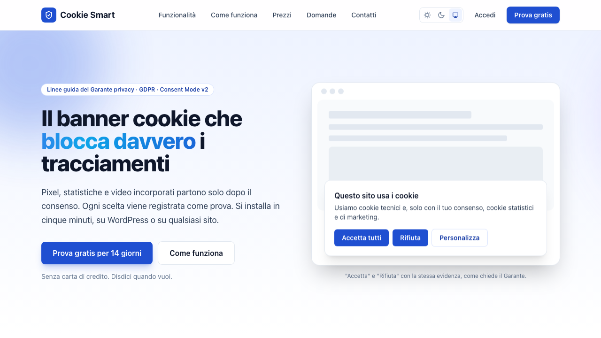

<p align="center">
  
</p>

<h1 align="center">Cookie Smart</h1>

<p align="center">
  <strong>Il banner cookie che blocca davvero i tracciamenti.</strong><br>
  Banner, blocco preventivo degli script, Google Consent Mode v2 e registro dei consensi,<br>
  secondo le linee guida cookie del Garante privacy.
</p>

<p align="center">
  <a href="https://cookiesmart.it/app/register"></a>
  &nbsp;
  <a href="https://cookiesmart.it/prezzi"></a>
</p>

<p align="center">
  <a href="https://cookiesmart.it"><strong>cookiesmart.it</strong></a> ·
  <a href="#plugin-wordpress">Plugin WordPress</a> ·
  <a href="#modulo-prestashop">Modulo PrestaShop</a> ·
  <a href="https://cookiesmart.it/contatti">Contatti</a>
</p>

<p align="center">
  <picture>
    <source media="(prefers-color-scheme: dark)" srcset="docs/images/home-scuro.png">
    
  </picture>
</p>

---

## Cos'è

Cookie Smart mette in regola con i cookie siti web ed e-commerce: un banner da installare con il plugin per
WordPress, con il modulo per PrestaShop o con una riga di codice su qualsiasi altro sito, gestito da un pannello online.

Un banner da solo non basta. Se Google Analytics, il pixel di Facebook o un video di YouTube partono prima che il
visitatore abbia scelto, il sito non è conforme anche se il banner c'è. Cookie Smart **blocca gli script prima che partano**
e li sblocca solo per le categorie che il visitatore accetta. Plugin e modulo li bloccano già nella pagina inviata dal server,
così il browser non li scarica nemmeno.

Dal pannello configuri colori e testi, vedi quali cookie usa il sito con la scansione automatica e consulti il registro dei
consensi, da esibire in caso di verifica.

## Funzionalità

- **Blocco preventivo** di Facebook Pixel, LinkedIn, TikTok, Hotjar, YouTube, Google Maps e degli altri servizi,
  su tre livelli: lato server (plugin e modulo), script creati via JavaScript e script inseriti nella pagina.
- **Google Consent Mode v2** per Analytics, Ads e Tag Manager.
- **Registro dei consensi** con IP troncato, export CSV e copia di ciò che il banner mostrava al momento della scelta.
- **Scansione dei cookie**: visita le pagine pubbliche del sito prima e dopo il consenso, riconosce i cookie e segnala ciò che parte senza consenso.
  I cookie delle aree riservate (es. area clienti) si aggiungono a mano dal pannello.
- **Personalizzazione**: colori, posizione, testi in italiano e inglese. Il banner è isolato dal tema e non ne rompe la grafica.
- **Per agenzie web**: più siti e più utenti nello stesso account, con accessi in sola lettura per i clienti.

## Conforme alle linee guida del Garante (10 giugno 2021)

- Nessun cookie non tecnico prima del consenso
- Pulsante «Rifiuta» con la stessa evidenza di «Accetta»
- Chiudere il banner con la X equivale a rifiutare
- Nessuna casella pre-selezionata, nessun cookie wall
- Scelta per singola categoria e preferenze sempre modificabili
- Banner non riproposto prima di 6 mesi, salvo modifiche

## Prova e abbonamento

**14 giorni di prova gratuita, senza carta di credito.** [Crea l'account](https://cookiesmart.it/app/register),
aggiungi il sito e installa il plugin, il modulo o lo script: il banner è attivo in pochi minuti.
Alla fine della prova scegli il piano e ti abboni con PayPal.

| Piano | Per chi | Siti | Utenti | Prezzo |
|---|---|:-:|:-:|--:|
| **Starter** | un singolo sito web | 1 | 1 | 60 € l'anno |
| **Pro** | piccole aziende con più siti | 5 | 3 | 180 € l'anno |
| **Agency** | agenzie web, con banner senza marchio (white label) | 50 | 10 | 480 € l'anno |

Abbonamento annuale, prezzi IVA esclusa. Tutti i dettagli su [cookiesmart.it/prezzi](https://cookiesmart.it/prezzi).

## Download

Plugin e modulo sono gratuiti: per funzionare serve un account Cookie Smart, anche in prova.
Si aggiornano da soli: quando esce una nuova versione la trovi tra gli aggiornamenti di WordPress
o in un avviso nel back office di PrestaShop.

### Plugin WordPress

<p>
  <a href="https://cookiesmart.it/download/wordpress"></a>
</p>

Richiede WordPress 6.0 o successivo e PHP 7.4 o successivo.

1. Scarica [`cookie-smart.zip`](https://cookiesmart.it/download/wordpress), l'ultima versione del plugin.
2. In WordPress: *Plugin › Aggiungi nuovo › Carica plugin*, scegli lo zip e attivalo.
3. Dal menu laterale **Cookie Smart** (icona dello scudo) inserisci la **chiave del sito**, che trovi nel pannello di Cookie Smart.
4. Escludi lo script di Cookie Smart da minificazione, combinazione e «ritardo JS» del plugin di cache.

Il plugin inserisce il banner come primo elemento della pagina e blocca gli script già lato server, anche con i plugin di cache attivi.
Le nuove versioni compaiono tra gli aggiornamenti dei plugin, anche con gli aggiornamenti automatici.

[Novità](wordpress-plugin/CHANGELOG.md) · [Tutte le versioni](../../releases?q=wordpress-v&expanded=true) · [Sorgente](wordpress-plugin/cookie-smart)

### Modulo PrestaShop

<p>
  <a href="https://cookiesmart.it/download/prestashop"></a>
</p>

Per PrestaShop 1.7.1 e successivi, 8 e 9.

1. Scarica [`cookiesmart.zip`](https://cookiesmart.it/download/prestashop), l'ultima versione del modulo.
2. Nel back office: *Moduli › Gestione moduli › Carica un modulo* e scegli lo zip.
3. *Configura*: inserisci la **chiave del sito**, che trovi nel pannello di Cookie Smart, e lascia attivo il *Blocco lato server*.
4. *Parametri avanzati › Prestazioni › Svuota la cache*.
5. Per il link «Preferenze cookie» nel footer: *Moduli › Link List*, link personalizzato con indirizzo `#cookiesmart-preferences`.

Il modulo inserisce il banner come primo elemento della pagina e blocca gli script già lato server, senza modificare il tema.
Quando esce una nuova versione compare un avviso nella dashboard del back office con il pulsante «Aggiorna».

[Novità](prestashop-module/CHANGELOG.md) · [Tutte le versioni](../../releases?q=prestashop-v&expanded=true) · [Sorgente](prestashop-module/cookiesmart)

### Qualsiasi altro sito

Incolla lo script, con la chiave del tuo sito, come **primo elemento** del `<head>` di ogni pagina:

```html
<script src="https://cookiesmart.it/api/c/LA-TUA-CHIAVE.js"></script>
```

Per un link «Preferenze cookie» nel footer usa l'indirizzo `#cookiesmart-preferences`.

## Licenza

- Il **plugin WordPress** è distribuito con licenza **GPL v2 o successiva**.
- Il **modulo PrestaShop** è distribuito con licenza **AFL 3.0** (Academic Free License).
- La **piattaforma Cookie Smart** (servizio online e pannello) è un software proprietario di PC Web Agency
  e non è inclusa in questo repository.

---

<p align="center">
  Cookie Smart è un servizio di <strong>PC Web Agency</strong> ·
  <a href="https://cookiesmart.it/contatti">Contatti</a> ·
  <a href="https://cookiesmart.it/privacy">Privacy</a> ·
  <a href="https://cookiesmart.it/termini">Termini di servizio</a>
</p>
